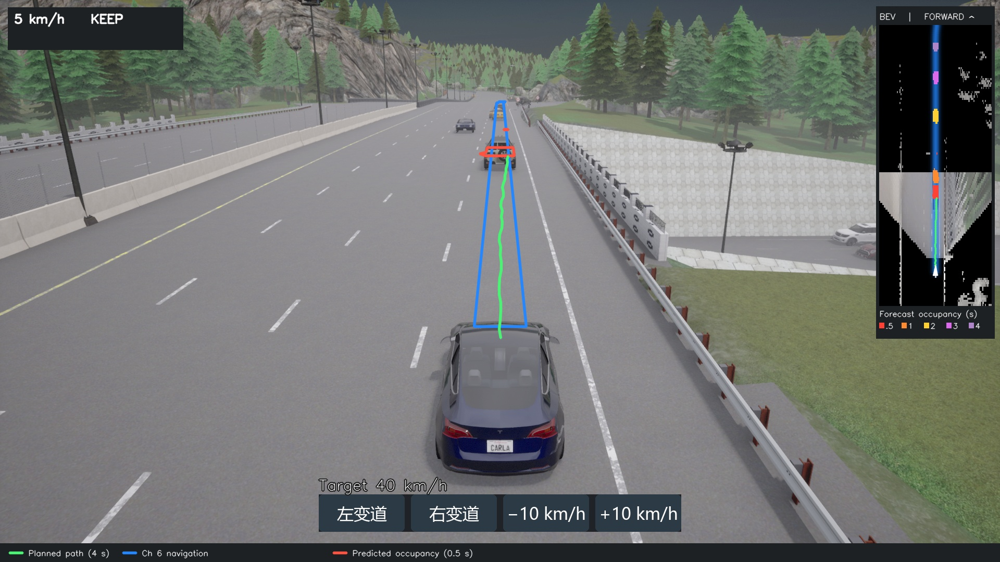
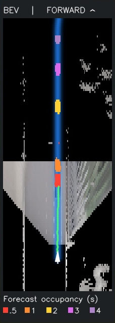

# Highway OCC Flow · v1

v1 是在 CARLA 0.9.15 的 Town04 和 Town06 上训练的单帧驾驶模型。第 22 轮权重使用同一张鸟瞰图（BEV）预测自车轨迹和周围交通的未来占用。鼠标面板提供左右变道和目标速度指令。

## 感知与规划

| 输入 | 在模型中的作用 |
| --- | --- |
| 前视 RGB（3 通道） | 将 640 × 360 图像投影到车前 45 米的地面，用当前帧 LiDAR 估计的地面平面修正投影 |
| LiDAR（3 通道） | 把高度、点密度和回波强度投影到同一网格，保留侧后方车辆和道路边界 |
| 导航走廊（1 通道） | 将选定路线与目标车道画成蓝带，为岔口分支和车道保持提供空间参考 |

7 个通道组成一张 128 × 128 的 BEV，覆盖车后 16 米至车前 112 米、左右各 25.6 米。二维 ResNet-18 提取空间特征。轨迹头结合实测车速和保持／左移／右移指令，以 0.1 秒为步长积分出未来 4 秒的 40 个轨迹点。占用头预测未来 0.5、1、2、3、4 秒的动态障碍物栅格。

## 从预测到控车

控制器沿绿色轨迹选取随车速和曲率变化的前瞻点。在保持车道时，近端蓝色导航走廊约束横向目标，LiDAR 提供车体周围的障碍物净空。纵向控制根据前车距离、相对速度、弯道曲率和同时刻预测占用调整油门与制动。面板目标速度作用于控制器，轨迹头使用当前实测车速。

点击左／右变道会挂起一个持续请求。空隙合适时执行并线，有侧车时根据相对位置加速寻隙、减速让行或等待。完成并线后锁存新目标车道，切回保持车道。

## Town04 第三人称实拍

第 22 轮权重，场景中有 18 辆 NPC。截图时自车以 5 km/h 保持车道，面板目标速度为 40 km/h。路面上的绿线是 4 秒规划轨迹，蓝色轮廓是导航走廊，前车附近的红色轮廓是 0.5 秒预测占用。

查看同一帧的右上角 BEV 局部原图

## 已验证的闭环表现

| CARLA 0.9.15 场景 | 第 22 轮实测 |
| --- | --- |
| Town04 固定路线，18 辆 NPC | 45 秒行驶 401.39 米，经过立柱时最近净距 2.90 米。该次 HIP Graph 推理 P95 为 3.31 毫秒 |
| 独立右岔口，1 条路线 | 分岔后 40 米的观察窗内，37/37 帧位于指定分支 |

[规划网络](v1_dual_system/fast_model.py) · [控制器](v1_dual_system/controller.py) · [BEV 渲染](v1_dual_system/chase_view.py)
