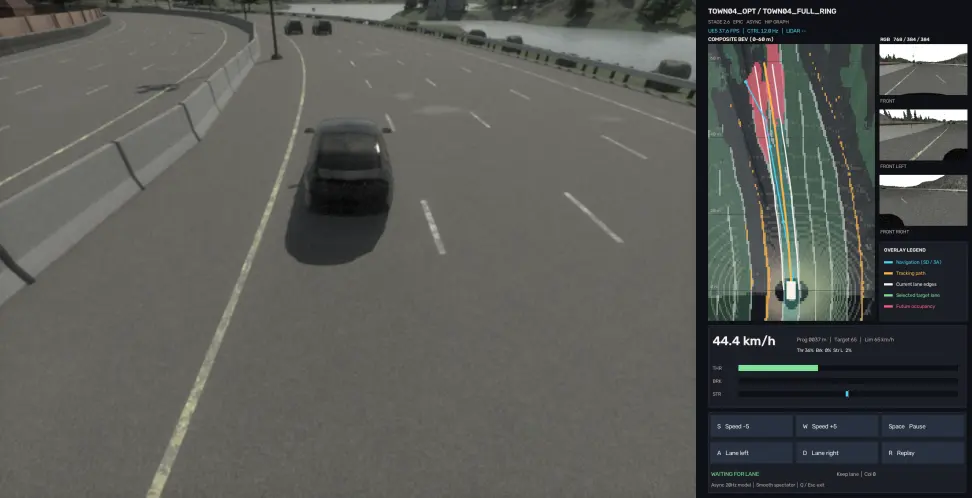
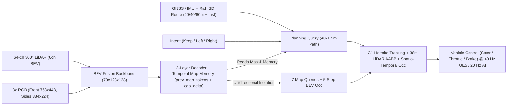

# BEV-WAM-X

无高精地图端到端感知规划与实时 CARLA 1.0（UE 5.8）闭环驾驶框架 —— 融合三目裸传感 BEV、360° 激光雷达占用预测、时序地图记忆与物理控制安全包络。



*CARLA 1.0 / UE 5.8 Epic 画质（`1824×1310` 3D 场景 + `712×1310` 战术 BEV）· 40 Hz 帧锁视角 + 20 Hz 感知规划 · 零样本 `Town04_Opt` 多车环线（12 NPC）平滑右并线（[查看高清截图](docs/images/v2/stage26-epic-shot.jpg)）*

---

## 核心亮点

- **纯传感无高精地图 BEV 感知与规划**：仅输入前摄 `768×448` + 左右侧摄 `384×224` 裸 RGB 与 64 线 LiDAR BEV，输出 7 条地图几何线、4 通道道路语义掩码、5 个未来时刻动态占用及 60 m 自车轨迹；OpenDRIVE 仅用于监督与判分。
- **时序地图记忆与 `0.0` 泄漏单向注意力隔离**：`Phase26` 引入跨帧 `prev_map_tokens` 与自车位姿变化 `ego_delta` 稳定长距离与岔口预测；地图查询严格隔离交互意图，左/右变道请求切换时地图预测差异实测为 **`0.0`**。
- **极端轻量化推理与 40 Hz 帧锁 Epic 实时演示**：`15.86M` 参数经 BatchNorm 折叠与 BF16 HIP Graph 优化，在 AMD RX 7900 XT 上单帧推理 P95 仅 **`5.86 ms`**（显存分配峰值 `0.174 GiB`）；演示端采用 40 Hz 独立渲染节拍 + 1 帧速度前瞻，彻底消除异步相机抽动。
- **零样本泛化与 C¹ 平滑变道控制**：`Town04_Opt` 未参与任何训练帧；在 `Town12` 独立验证出口与 `Town04_Opt` 全 9 条闭环测试中完成 **`10,989` 帧 `0` 碰撞**，结合 C¹ Hermite 变道接续与 38 m LiDAR 包围盒加速（`3.05x`），高速并线偏出 **`0` 帧**且不引发虚假降速。

---

## 系统架构



---

## 核心性能速览

| 评估维度 | 实测表现 | 测量条件 |
| --- | --- | --- |
| **端侧推理耗时** | **`5.86 ms`**（墙钟 P95）/ **`0.174 GiB`** 分配显存 | RX 7900 XT · BF16 HIP Graph（vs Eager 差值 `0.0`） |
| **独立地理验证** | 0–24 m L1 **`0.074 m`** · 出口 `0.086 m` · 弯道 `0.045 m` · mIoU `68.38%` | `Town12` 独立验证集（2,000 帧） |
| **闭环安全与导航** | **9 条路线 `10,989` 帧 `0` 碰撞** · `Town12` 出口 **`1/1`** · 环线 P95 **`0.337 m`** | CARLA 1.0 / UE 5.8 · High 640×360 · 20 Hz |
| **高速并线保持** | 4 项变道请求入道后偏出均 **`0` 帧** · 目标道横向 P95 **`0.247–0.389 m`** | `Town04_Opt` 零样本 50–75 km/h 交互回归 |
| **Epic 双窗口演示** | UE5 平均 **`40.89 FPS`** · 连续行驶 `3,402.7 m` · `0` 碰撞 · 偏移 P95 `0.450 m` | CARLA 1.0 Epic `1824×1310` · 12 NPC · 40 Hz 帧锁 |

> 完整训练配置、显存拆分、逐路线延时（含 `38 m LiDAR` 加速前闭环基线）及已知边界，请参阅 [详细训练与闭环技术报告](v2_mapless_wa/doc/issue.md)。

---

## Stage 3 展望（迈向隐空间世界模型）

Stage 2.6 目前仍受限于“几何轨迹预测 + 下游规则控制”，变道需人工触发，过弯与跟车手感依赖显式物理公式。**Stage 3** 将全面转向 **“隐空间动作条件世界模型 + 梦境强化学习”**：

1. **摆脱纯模仿上限（DreamerV3 / TD-MPC2 范式）**：复用 Stage 2.6 BEV 感知表征热启动紧凑隐空间，构建动作条件世界模型并在隐空间内并行滚演未来数秒交通演化与碰撞风险，不再局限于“复刻老司机教师数据”。
2. **自主战术变道与借道超车**：以“安全惩罚 + 通行效率（超越慢车收益）+ 舒适度惩罚”直接驱动连续策略进化，让模型自发学会辨识前方低速障碍、判断邻道空当并果断完成切出-超车-汇回全流程。
3. **刷新率解耦与拟人舒适度体系**：UE5 显示与底层执行放开至 **`40–60 Hz`**，世界模型决策解耦在 **`10–20 Hz`**；正式引入变道最大掉速、方向盘转角与角速度、横纵向急动度（jerk）与动态跟车时距（THW）评测门禁。
4. **本地仿真 × Colab A100 进化飞轮**：本机 `RX 7900 XT + CARLA 1.0` 承担多车交互在线试错采样与 Epic 实车验收，`Colab A100` 负责高吞吐隐空间世界模型与百万步梦境 RL 迭代。

---

## 快速体验与仓库结构

```powershell
# 启动 Town04_Opt 3 圈 9.21 km Epic 实时演示（默认 40 Hz 帧锁视角 + 12 NPC）
.\scripts\Start-Stage26Demo.ps1

# 或运行独立 9 路线 / 场景闭环评测（20 Hz 同步）
.\.venv-train\Scripts\python.exe -m v2_mapless_wa.phase2_live --out data/v2-mapless-wa/eval --weights <stage26.pt>
```

快捷键：`A / D` 左右并线 · `W / S` 巡航车速 `±5 km/h` · `Space` 暂停 · `R` 重开 · `Esc / Q` 退出。

```text
bev-wam-x/
├── v2_mapless_wa/          # v2 (Stage 2 → 2.6) 模型、训练、控制、评测与实时演示源码
│   ├── doc/issue.md        # 详细训练过程、消融与闭环技术报告
│   └── PHASE1_REPORT.md    # 三目投影标定报告
├── v1_dual_system/         # v1（CARLA 0.9.15）冻存基线
├── scripts/                # Windows 演示与环境启动脚本
└── docs/images/v2/         # Epic 演示动图与高清截图
```

[详细技术报告](v2_mapless_wa/doc/issue.md) · [Phase 1 三目标定报告](v2_mapless_wa/PHASE1_REPORT.md) · [v1 冻存版本](https://github.com/AuroNoxx/bev-wam-x/tree/v1)
